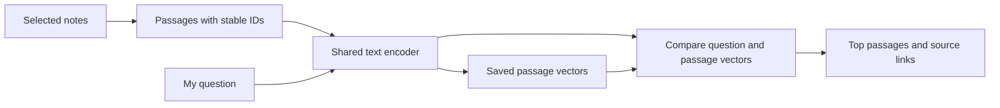

# Semantic Notes Search

I want to search my AI notes by meaning. A question such as “why do gradients disappear?” should find a passage about vanishing gradients even when the question and the passage use different words.

**Status:** planned — project directory, README and launcher resource profile. Created on 2026-10-13. Implementation, data preparation, fine-tuning and Colab recovery have not started.

## What I'll build

The first version will take a question and return the five most relevant passages, with their document title, section, source path and similarity score. I'll be able to open the original note from a result.

The learning goal is to understand how a Transformer encoder turns text into vectors, how a training objective changes those vectors, and how that affects retrieval. This project uses a pretrained encoder and then **fine-tunes it**; the training phase is part of the project, beyond loading an existing model.

Example questions to try later:

- “What is the difference between padding and causal masks?”
- “Why do residual connections help training?”
- “What must I save to resume training after Colab disconnects?”

These are proposed demo questions, not measured retrieval results.

## How the encoder fits



The starting candidate is [`sentence-transformers/all-MiniLM-L6-v2`](https://huggingface.co/sentence-transformers/all-MiniLM-L6-v2). Its model card describes 384-dimensional embeddings and a default limit of 256 word pieces. I'll pin the exact model revision and tokenizer when implementation starts.

I'll keep passages within the tokenizer's limit, use the model's attention-mask-aware pooling, and normalize the embeddings. With normalized vectors, a dot product gives cosine similarity. Questions and passages use the same encoder weights. The output is retrieved text; an answer-generating model would be a separate extension.

For the first small corpus, exact vector comparison is enough. A vector database can wait until corpus size makes it useful. The [Sentence Transformers search guide](https://www.sbert.net/examples/sentence_transformer/applications/semantic-search/README.html) is the implementation reference.

## Data and training plan

I'll begin with a small, explicitly selected collection of my notes or reusable educational text. Corpus selection, permission to use it in Colab, source provenance and any licenses are kickoff decisions. No notes have been copied or uploaded yet.

Each passage will have a stable ID, document/section identity, original source location and content hash. Chunk length and overlap will be recorded in the configuration so a rebuilt index is reproducible.

The initial annotation budget is **a few hundred question–relevant-passage pairs**, adjusted after looking at the corpus. I'll write questions that require matching meaning, including paraphrases, and label other valid answers where several passages are relevant.

Training will pull a question's vector closer to relevant passages and away from unrelated passages using a contrastive retrieval loss. I'll inspect batches for duplicate positives and false negatives: a passage relevant to another question must not automatically become an unrelated example. The [training overview](https://www.sbert.net/docs/sentence_transformer/training_overview.html) will guide the loss and trainer choice.

I'll group train/validation/test questions by their source documents and keep near-duplicate passages and question variants in the same group. Held-out documents can be present in the search index; their question labels must stay out of training. Validation chooses settings; the frozen test questions are used for the final comparison.

## How I'll see whether training helped

I'll compare three approaches on the same corpus and held-out questions:

| Approach | Purpose |
| --- | --- |
| BM25 keyword search | Check whether embeddings add value over word matching |
| Original pretrained encoder | Establish retrieval quality before my fine-tuning |
| Fine-tuned encoder | Measure the effect of my training |

The primary metric will be **Hit@5**: the fraction of questions with at least one judged relevant passage in the first five results. I'll also report **MRR@10**, the average reciprocal rank of the first relevant result within ten, with zero for a miss. I'll record the number of evaluated questions alongside both metrics.

The result notebook will show training/validation curves, before-and-after search rankings, and examples of good matches and failures. A lower training loss alone won't count as improved retrieval. If fine-tuning hurts held-out results, I'll record that outcome and retain the original encoder as the stronger baseline.

Every saved index will identify its encoder revision, tokenizer, chunking configuration and corpus hash. After changing encoder weights, I'll regenerate passage vectors before evaluating the new model.

## Colab plan

I'll aim for a bounded Colab Free profile, starting with short passages and a small batch. Actual memory use and step time will be measured before choosing the training budget. A tiny CPU run comes first.

The implementation will live in importable Python files. A thin, output-cleared notebook will call the same preparation, training, resume and evaluation code used locally. The initial source-transfer route can be a source ZIP; the notebook must work independently of this workspace.

I'll follow the [workspace Colab contract](../../../docs/guide/COLAB.md):

- Keep runtime-local data caches separate from persistent Drive checkpoints.
- Save model, optimizer, scheduler, any gradient scaler, global progress, RNG and data-order state, plus source/model/data/config identities.
- Start with sessions bounded by 60 minutes or 1,000 additional optimizer updates, and save after five minutes or 100 completed updates, whichever comes first; revise only from pilot measurements.
- Verify immutable checkpoint generations and retain an older valid fallback.
- Delete the runtime, restore in a fresh one, and prove that training continues from the saved update.

Colab fit and recovery are planned requirements, not verified capabilities.

## Files to add when I start

The README and launcher resource profile are ready; implementation files are still to be added. This is the proposed implementation layout:

```text
pyproject.toml + uv.lock   Local environment and dependencies
src/semantic_notes_search/
  corpus.py               Read notes, chunk text and preserve source IDs
  encoder.py              Load/pool/normalize the text encoder
  train.py                Contrastive fine-tuning and full-state resume
  search.py               Build/load an index and return ranked passages
  evaluate.py             Fixed retrieval comparisons and examples
configs/                  CPU smoke and proposed Colab Free profiles
notebooks/colab.ipynb      Setup, baseline, train, resume and inspect
tests/                    Chunk identity, known-vector ranking and recovery
docs/                     Data/model provenance and measured results
```

Data, indexes, model weights, checkpoints, environments and generated runs will stay out of Git. This is an ordinary directory tracked by the ai_projects repository, inside the Transformer Labs group.

## Starting points and completion

| Step | What I'll do | Evidence to keep |
| --- | --- | --- |
| 1. Corpus and baselines | Select notes, create labeled splits, run BM25 and the original encoder | Source/split manifest and baseline rankings/metrics |
| 2. Training smoke | Check pooling, ranking, loss and gradients; overfit a tiny labeled set | Numerical checks, finite gradients and a saved/reloaded run |
| 3. Colab fine-tuning | Run a measured, bounded training profile | Resource measurements, learning curves and persistent checkpoints |
| 4. Retrieval comparison | Evaluate the frozen test questions and inspect mistakes | Comparable metrics, rankings and failure examples |
| 5. Recovery and demo | Resume after runtime deletion and search fresh questions | Hosted recovery evidence and a usable search demo |

**First session later:** prepare the project environment, select the first corpus, pin dependencies and the model revision, then build the untrained retrieval baseline. Each implementation step will get its own checks and checkpoint as I reach it.

The project is complete when I have a usable notes-search demo, an actual fine-tuning run, an honest held-out comparison, and verified fresh-runtime recovery. An improvement is a result to measure, not a promised outcome.

The other planned encoder project is [Tiny Vision Transformer](../tiny-vision-transformer/README.md). The two can be started independently.
