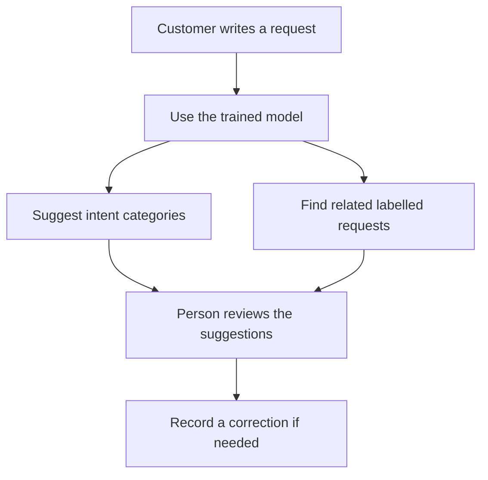
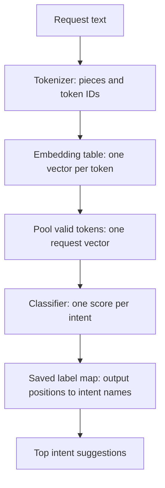
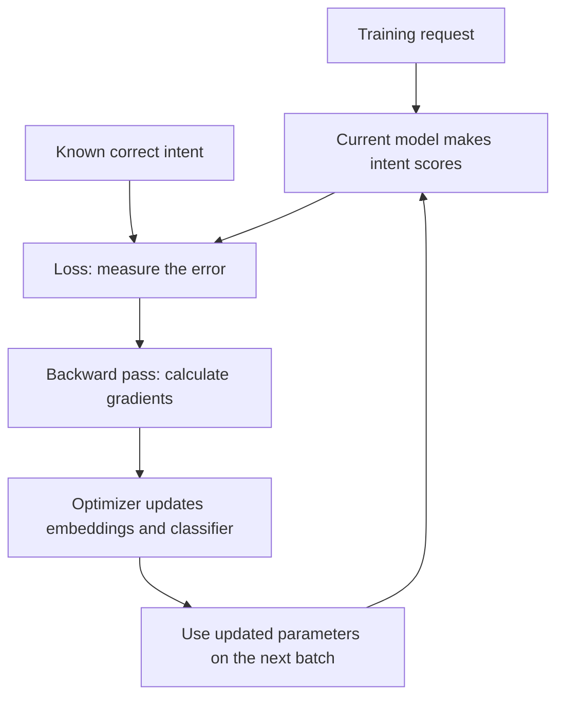
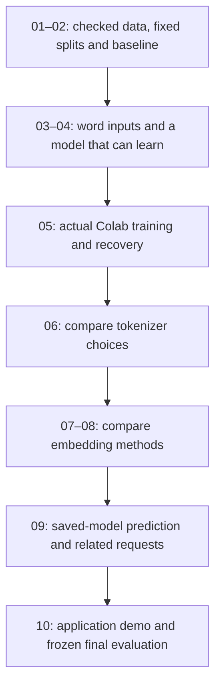

# Support Ticket Router — project overview and phases

I want to build a small application that reads a customer's support request, suggests the kind of help they need and shows related requests. While building it, I want to understand how the text becomes numbers, how those numbers are learned and how the model chooses an intent.

**Core goal:** Train embeddings and an intent classifier; compare word tokenization, BPE and subwords.

**Current state:** the locked Python scaffold and standalone entry files exist. Detailed phase requirements are prepared. Dataset acquisition, tokenizer/model implementation, training and the application are still pending. This page explains the intended build; its examples are illustrative.

## 1. What are we trying to build?

Imagine someone writes:

> My card keeps getting declined when I try to pay.

The application should suggest a suitable category, such as `card_not_working`, and show a few related labelled requests. A person can review the suggestions and record a corrected category if needed.

An **intent** means the kind of help the customer wants. Different messages can describe the same intent. “My card is being declined” and “I cannot pay with my card” may need the same category even though their words differ. That is the practical problem our classifier will learn to handle.

The first version will offer:

- A place to enter a fresh request.
- The highest-scoring intent suggestions.
- Related labelled requests from the training archive.
- A correction record for later human review.
- A comparison of the trained tokenizer and embedding variants.

An intent can later be connected to a support queue once we define the queue mappings. The first task is to predict the intent itself.



This diagram shows the intended application flow. A correction is saved for review; it does not silently retrain the model.

## 2. How does a sentence become a prediction?

Follow this invented request through the first neural model:

```text
Request:       "card declined again"
Word tokens:   ["card", "declined", "again"]
Token IDs:     [7, 18, 4]
Embedding:     look up a learned vector for each ID
Pooling:       average the valid token vectors
Classifier:    score each possible intent
Label map:     turn the highest-scoring output positions into intent names
```

The tokens and IDs here are teaching examples. Actual results depend on the tokenizer we fit and the model we train.

### Tokenization: decide which pieces to read

A **tokenizer** breaks text into pieces called tokens. A word tokenizer might treat `payment` as one piece. A subword tokenizer might use smaller pieces such as `pay` and `ment`, depending on its learned vocabulary.

Those pieces receive IDs so the program can look them up. Token ID `7` does not mean “more important than token ID `4`.” It is an address in a vocabulary.

### Embeddings: give those pieces learned numeric representations

An **embedding** is a vector: a list of numbers associated with a token. The model learns these numbers during training. Individual coordinates do not have fixed human names such as “banking” or “urgency.”

For a tiny three-coordinate illustration:

| Token | Illustrative vector |
| --- | --- |
| `card` | `[0.2, -0.1, 0.4]` |
| `declined` | `[0.4, 0.3, 0.2]` |
| `again` | `[0.0, 0.1, 0.3]` |

These values are invented, not trained vectors. They show the structure of the representation.

### Pooling: make one vector for the whole request

Our first model will average the valid token vectors. With the invented vectors above, the request vector is `[0.2, 0.1, 0.3]`. **Pooling** is the step that combines several token vectors into one request vector.

When we process different-length requests together, shorter requests need padding. Padding fills unused positions and must be excluded from this average.

This first model is small enough to inspect and train. Averaging also loses word order, which is a limitation we should remember when reviewing its mistakes.

### Classification: choose among the intent names

The **classifier** uses the request vector to produce a score for each intent. A saved label map tells us which intent name belongs to each output position. The application can show the top three suggestions.

An **intent ID** identifies a possible answer. A **token ID** identifies a piece of the input. They are separate lists with separate meanings.



We will build and check each step separately before connecting the complete path.

## 3. What does training actually do?

During training, we give the model a request **and its known correct intent**. It makes a prediction, we measure the error and then update its learned numbers.

For example, the training label might say `card_not_working`, while the model gives a higher score to another intent. The **loss** measures how poorly its scores fit the correct answer. **Gradients** tell the optimizer how changing the parameters affects that loss. The **optimizer** uses those gradients to update the parameters.

In the first neural model, both the embedding table and classifier learn from this intent task. After an update, the model's scores can change. Improvement on fresh requests must still be measured; memorizing training examples is not enough.



The loop describes learning. Once a model is trained, making a prediction for a new request does not require knowing its correct intent or updating the model.

## 4. What exactly are we comparing?

We have two related questions. Keeping them separate makes the results easier to understand.

### Question A: how should we split the text?

| Tokenizer | Simple description | What we want to observe |
| --- | --- | --- |
| Word tokens | Use word-level pieces under an explicit punctuation/normalization policy. | Vocabulary coverage and behavior on words absent from training. |
| Byte-level BPE | Start from byte-sized units and learn frequent merges into larger pieces. | Vocabulary size, request length and behavior on unusual text. |
| SentencePiece Unigram | Learn a vocabulary and probabilities for pieces, then choose a segmentation under that model. | How another subword method changes the same routing task. |

**BPE is itself a subword method.** Our three concrete choices are word tokenization, byte-level BPE and Unigram. “Subwords” is not a fourth unnamed tokenizer. See the [BPE explanation](https://huggingface.co/learn/llm-course/en/chapter6/5) and [SentencePiece documentation](https://github.com/google/sentencepiece).

More pieces can make requests longer; a larger vocabulary can make the embedding table larger. We will measure those costs along with prediction quality. We will not assume that a particular tokenizer wins before running the comparison.

### Question B: how should the embeddings learn?

| Representation | How it learns | What we want to find out |
| --- | --- | --- |
| Embeddings trained with the classifier | Start from random values and update them using the known intents. | How much the routing task can teach the representation directly. |
| Word2Vec embeddings | Learn from nearby words in training text, then use the vectors to initialize the intent classifier. | Whether context-based training gives the classifier a useful starting point. |
| Character n-gram representations | Combine vectors for short character sequences inside words and learn them with the intent classifier. | Whether shared character pieces help represent rare or unseen words. |

Word2Vec learns from word context rather than intent labels during its embedding-training stage. Our planned implementation uses Skip-gram with negative sampling, explained in Phase 07. Its technical source is the [Word2Vec paper](https://arxiv.org/abs/1310.4546).

For the representation comparison, we keep the word segmentation and classifier policy consistent. Character pieces used to form a word vector are a separate experiment from changing the sentence tokenizer to BPE.

An unseen word can sometimes share known character pieces with training words. That gives us a way to form a representation; whether it improves routing is a result to measure.

## 5. Which data will we use, and how will we judge the result?

We start with **Banking77**, which provides banking-support requests and their intent labels. Its official description lists 10,003 training examples, 3,080 test examples and 77 intents. We will verify the selected source file when acquiring it. See the [official dataset description](https://github.com/PolyAI-LDN/task-specific-datasets#banking).

This gives us a concrete domain and known answers. The related-request feature will show labelled examples from this dataset; resolution histories would require another archive.

We will use three data roles:

| Data role | Purpose | When it is used |
| --- | --- | --- |
| Training portion | Fit the vocabulary/tokenizers and learn model parameters. | During fitting and training. |
| Validation portion | Inspect fresh-example performance and choose settings. | During development and comparisons. |
| Official test set | Assess the selected, frozen configurations. | Final evaluation in Phase 10. |

Training and validation come from the official training pool. Duplicate or closely related requests must be inspected and grouped appropriately before splitting. Otherwise, a nearly identical request on both sides could make performance look better than it is.

The most useful measurements are:

- **Accuracy:** the fraction of requests whose first suggested intent is correct.
- **Macro-F1:** average the F1 score for each intent with equal weight. F1 balances precision and recall; this helps expose weak intents that an overall score can hide.
- **Top-three accuracy:** whether the correct intent is among the three suggestions.
- **Concrete mistakes:** which intents get confused, and what the requests actually say.
- **Cost:** training time, model size, memory and prediction time on recorded hardware.

A fair comparison uses the same saved splits and classifier design where specified. We record differences in vocabulary, parameter count, sequence length and training budget so the numbers have context. Validation guides our choices; the test set stays reserved until those choices are frozen.

## 6. The phase route at a glance

Every phase below is planned. Each has a small deliverable that the next phase can use.

| Phase | Main question | What we keep at the end |
| --- | --- | --- |
| [01 — Data and intent IDs](plan/phase-01-data-contract.md) | Can we trust the examples and their answers? | Checked records, source identity and saved label map. |
| [02 — Splits and baseline](plan/phase-02-splits-and-baseline.md) | How will we measure progress fairly? | Fixed splits and a simple text-classifier reference. |
| [03 — Word tokens and batches](plan/phase-03-word-tokenization-and-batches.md) | How do requests become usable model inputs? | Saved word vocabulary, token IDs and padded batches. |
| [04 — First neural classifier](plan/phase-04-joint-embeddings-and-classifier.md) | Can the embeddings and classifier learn together? | A checked model and a tiny learning sanity check. |
| [05 — Colab training and recovery](plan/phase-05-colab-training-and-recovery.md) | Can we train the real task and survive runtime loss? | Trained artifacts, validation results and recovery proof. |
| [06 — Tokenizer comparison](plan/phase-06-tokenizer-comparison.md) | What changes with word tokens, BPE and Unigram? | Comparable runs and a tokenizer results table. |
| [07 — Word2Vec](plan/phase-07-word2vec-embeddings.md) | Does learning from word context help? | Trained word vectors and a classifier using them. |
| [08 — Character pieces](plan/phase-08-character-ngram-embeddings.md) | Do character-based word vectors help? | Trained character representations and embedding comparisons. |
| [09 — Fresh requests and related examples](plan/phase-09-inference-and-related-requests.md) | Can saved models power the application functions? | Reloadable prediction and related-request functions. |
| [10 — Demo and final review](plan/phase-10-application-and-final-review.md) | Does the complete application work on held-out data? | A usable demo, frozen test comparison and reviewed failures. |

### Phase 01 — Prepare the requests and correct answers

Load the exact source version, read the CSV properly and reject unusable records. Preserve the original request text. Collect the intent names, sort them and give each a stable numeric ID.

For a tiny two-intent example, `card_arrival` could be ID `0` and `card_not_working` ID `1`. The real mapping comes from the complete official training inventory. Row order must not change that mapping.

**Why this comes first:** every later step depends on knowing which text and correct answer it is using.

**End result:** checked request/intent records, source metadata, a reloadable label map and a small preview. We work in two chunks: raw records first, then numeric targets. Splitting and training start later.

### Phase 02 — Separate learning from evaluation and build a baseline

Inspect duplicates, freeze the training/validation membership and build a simple TF-IDF classifier. TF-IDF turns word occurrences into weighted numeric features; a linear classifier uses them to choose an intent.

A **baseline** is our first measured reference. If a more complicated learned model performs worse, we should be able to notice and investigate it.

**Why this matters:** we need a trustworthy way to check fresh requests before changing embeddings or tokenizers.

**End result:** saved splits, a reproducible baseline and validation mistakes to inspect. We review split safety first, then the baseline.

### Phase 03 — Turn words into IDs and batches

Define the word tokenizer's behavior, fit its vocabulary on the training portion and encode requests. Handle unknown words explicitly. Then combine different-length requests into padded batches.

For example, a three-token request and a two-token request can share a three-position batch if the second request has one padding position. A mask marks which positions contain real tokens.

**Why this matters:** the neural model needs numeric inputs and must know which positions are padding.

**End result:** a saved tokenizer and checked batches containing token IDs, masks and intent targets. One complete request-to-batch walkthrough is the natural review chunk.

### Phase 04 — Build the first model that learns

Connect the embedding table, masked averaging and classification head. Check its forward calculation, loss and gradients. Then let it learn a tiny fixed batch with a bounded number of updates.

An **overfit check** deliberately asks the model to learn a few known examples very well. It helps detect broken data, gradients or updates. It does not establish performance on new requests.

**Why this matters:** a short, inspectable check should work before we spend time on a larger training run.

**End result:** the first neural model and evidence that both its embeddings and classifier can update. We review the forward path before the learning check.

### Phase 05 — Train on Colab and recover after interruption

Use the same Python trainer through a thin Colab notebook. Start with a bounded pilot, measure its costs and choose a practical Colab Free training budget. Track validation performance during the actual task training.

A **checkpoint** must save enough state to continue learning: model parameters, optimizer state, progress, random/data-order state and the identities of the code, data and configuration. Saving only the weights does not preserve the complete training process.

Then lose the runtime, restore the run in a fresh one and prove that training continues from the saved update. Persistent storage and an older valid checkpoint protect against an incomplete newest save.

**Why this matters:** the training result must survive the temporary Colab runtime.

**End result:** trained artifacts, measured validation results and an executed recovery record. This phase has natural stops for local state checks, the hosted pilot and fresh-runtime recovery. Tiny local checks support development; the actual hosted run establishes Colab training and recovery.

### Phase 06 — Compare word tokens, BPE and Unigram

Implement educational byte-level BPE and fit a Unigram tokenizer through a pinned implementation. Train compatible classifier variants using the same splits and declared comparison budget.

Show how the same request is split by each tokenizer. Measure vocabulary size, request length, truncation and routing results. **Truncation** means cutting a request to fit the chosen maximum length; it can remove useful information.

**Why this matters:** changing the text pieces changes what the model can represent and how much processing it needs.

**End result:** saved tokenizer/model variants and an honest validation comparison. We review the tokenizer behavior first, then the trained comparison. These measurements answer our application's question, not a universal ranking of tokenizers.

### Phase 07 — Train Word2Vec and use its vectors

Create word-context examples from training requests. With **Skip-gram**, a selected word learns to score nearby words. **Negative sampling** also gives it sampled words to distinguish from observed context pairs. Keep context windows within the declared request boundaries.

After checking a tiny learning example, train the embeddings on Colab and transfer the correct word-vector rows into the classifier. Decide explicitly whether the classifier keeps those vectors fixed or continues updating them.

**Why this matters:** it lets us compare learning representations from word context with learning them directly from intent labels.

**End result:** trained Word2Vec vectors, inspected neighbors and a classifier run using them. We review the context objective before training and transfer. The small request corpus may limit vector quality, so useful semantic structure is something to inspect rather than promise.

### Phase 08 — Learn word vectors from character pieces

Represent words using short overlapping character sequences, called **character n-grams**. For a simple illustration, `card` contains the three-character pieces `car` and `ard`; the implementation will define its full boundary and length policy.

Combine learned vectors for these pieces into a word representation and train it with the intent classifier. Preserve unseen word spellings so their character pieces can actually be used.

**Why this matters:** word-level unknown handling can lose the distinction between different unseen words. Shared character pieces may retain useful information.

**End result:** a trained character-based model and a comparison with joint word embeddings and Word2Vec-based initialization. We review word-vector composition first, then training and validation results. We keep sentence word segmentation consistent for this comparison.

### Phase 09 — Load saved models and handle fresh requests

Load a compatible tokenizer, model and label map. Apply the same input processing used in training and return top intent suggestions with their model scores.

Also build a small searchable archive of training requests using the chosen representation. A fresh request becomes a query; the archive returns related labelled examples. When model weights change, its archive vectors must be rebuilt or rejected as stale.

**Why this matters:** the application must work from saved artifacts, including after restarting Python.

**End result:** working prediction and related-request functions with clear handling of empty inputs and incompatible artifacts. We review inference first, then retrieval. Scores are shown as model scores; describing them as calibrated confidence would require a calibration check.

### Phase 10 — Finish the demo and make the final comparison

Connect request entry, intent suggestions, related examples and correction recording. Choose any “needs review” threshold using validation data, then freeze the selected configurations.

Evaluate those configurations on the reserved official test set. Record overall results, per-intent mistakes, top-three accuracy and measured application cost. Keep spelling changes and unsupported-domain probes separate from ordinary test metrics.

**Why this matters:** a working interface and a credible held-out result are both part of the project.

**End result:** a usable local demo, a final comparison and a reviewed account of strengths and failures. We review the application behavior first, then the frozen evaluation and complete request flow. Corrections remain separate review records and do not change the evaluation labels.

## 7. Why this order?

The first five phases build a trustworthy path from labelled data to a trained, recoverable classifier. The next three investigate tokenization and embeddings. The last two turn the saved models into the application and finish evaluation.



These arrows describe our build and teaching order. They do not mean BPE is an input to Word2Vec: Phase 07 uses the consistent word-level pipeline for its separate representation experiment.

The first neural architecture is embedding lookup, pooling and a small classifier. A tiny Transformer encoder is a possible later extension once this simpler application works.

## 8. How we'll work through a phase

1. State what the phase needs: purpose, prerequisites, inputs, outputs, checks and stopping point.
2. Explain a worked whiteboard example with a concrete request or small numeric case.
3. The assistant writes the code and focused tests for that chunk.
4. Review the code's data flow, results and a meaningful failure case together.
5. Record what passed and what remains before continuing.

We keep the work small by choosing a useful stopping point, not by forcing every phase into the same size. Most phases have two natural chunks. Phase 03 can use one batch trace; Phase 05 needs separate training/recovery steps. General Python syntax is assumed; the model and mathematical ideas are explained where they first matter.

Executable inputs stay visible in the standalone files' main blocks. Reusable implementation stays in the importable package. The Colab notebook calls the same project code rather than owning a second trainer.

## 9. What will count as completing the project?

The project is complete when we have:

- Actually trained embeddings and an intent classifier on Colab.
- Compared word tokens, byte-level BPE and Unigram on the saved routing task.
- Compared the planned embedding methods with their policies and costs recorded.
- Shown held-out performance and inspected real successes and mistakes.
- Built a fresh-request demo with related examples and correction recording.
- Proved that an actual Colab training run continues after runtime loss.
- Reviewed one complete prediction path and explained the important tradeoffs.

The scaffold, diagrams and plans prepare that work; they do not complete these checks.

## 10. Where to start and where the detailed plans live

Start with [Phase 01 — requirements and whiteboard](plan/phase-01-data-contract.md). The next step is its first chunk: follow one raw CSV record through reading and validation, then implement and review that piece.

`plan/` contains the detailed phase Markdown and [local planning checkpoint](plan/00-resume.md). It is ignored by Git. This overview remains Git-eligible, so a fresh clone retains the complete high-level route even though the local detailed plans are absent.

Raw datasets, trained tokenizers, weights, checkpoints and generated runs stay in their ignored destinations. The [project README](README.md) explains the existing files and standalone run commands; the [Colab requirements](docs/COLAB.md) describe the hosted training/recovery contract.
