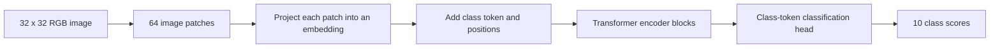

# Tiny Vision Transformer

I want to build a small Transformer encoder that recognizes images, train it from scratch on Colab, and inspect its predictions. Instead of words, the encoder will receive a sequence of image patches.

**Status:** planned — project directory, README and launcher resource profile. Created on 2026-10-13. Model implementation, dataset acquisition, training and Colab recovery have not started.

## What I'll build

The first task will be **CIFAR-10 image classification**: choose one of ten labels such as airplane, cat, ship or truck. I'll implement the patch embedding, positional embeddings, encoder blocks and classification head in Python/PyTorch, then train the whole model from randomly initialized weights.

The learning goal is to follow an image through every tensor operation and see how training changes predictions. This will be a small educational ViT, with explicit departures from the original paper's large models and pretraining setup.

The final notebook will display images beside their predicted and correct labels, prediction scores, training curves, a confusion matrix and selected attention patterns.

## How the encoder fits



The reference is [An Image Is Worth 16x16 Words](https://arxiv.org/abs/2010.11929). The [Keras ViT example](https://keras.io/examples/vision/image_classification_with_vision_transformer/) is a useful companion for patch processing and the training flow; my implementation will use PyTorch and the class-token design described here.

For the proposed Colab model:

| Stage | Tensor shape / starting choice |
| --- | --- |
| Input | `(batch, 3, 32, 32)` |
| Patch extraction | 64 patches, each containing `4 × 4 × 3 = 48` values |
| Patch projection | `(batch, 64, 128)` |
| Class token + learned positions | `(batch, 65, 128)` |
| Encoder | 4 blocks, width 128, 4 attention heads, FFN width 512 |
| Classification head | Final LayerNorm, class-token selection, linear output `(batch, 10)` |
| Training loss | Cross-entropy on logits and integer class labels |

Each encoder block will use pre-norm multi-head self-attention, residual connections and a GELU feed-forward network. Attention is bidirectional over all image tokens. The classification head's softmax scores are for inspection; cross-entropy receives logits directly.

These dimensions are a proposed learning profile. I'll count the actual parameters and measure RAM/VRAM and throughput after implementation. A CPU correctness profile will use one block, width 32, four heads and a tiny batch, while preserving the same image-to-patch flow.

## Dataset plan

[CIFAR-10's original dataset page](https://www.cs.toronto.edu/~kriz/cifar.html) describes 60,000 RGB images at 32 × 32 pixels, with 50,000 training images and 10,000 test images across ten classes.

I'll acquire the dataset through a reproducible loader, record its source/checksums and inspect its usage terms. Images and downloaded archives will stay outside Git.

I'll split the official training set into a seeded, stratified **45,000-image training set and 5,000-image validation set**. The official test set will stay reserved for final evaluation after configuration choices are frozen. The first training pilot can use a fixed subset of the train/validation splits, with the exact IDs recorded.

For the initial run, I'll use training-only random crops and horizontal flips plus recorded channel normalization. Validation and test preprocessing will be deterministic. Stronger augmentation and larger models can follow only after the basic model and baseline work.

## Training plan

1. Inspect real images and visualize patch extraction before building attention.
2. Check patch order, shapes, attention probabilities, residual paths, gradients and loss against small known cases or an independent PyTorch reference.
3. Overfit a tiny, fixed batch to check that the model and optimizer can learn.
4. Establish a small CNN baseline on the same splits, and record the 10% uniform-chance reference for the balanced ten-class task.
5. Run a bounded ViT pilot with AdamW, a recorded learning-rate schedule and seed, then choose the larger run budget from measured step time and validation behavior.
6. Compare frozen models on the test set and inspect the errors.

I'll keep the first run simple before introducing mixed precision, extra augmentation or parameter sweeps. Batch size, total updates, dropout and optimizer settings will be finalized during the pilot. Session boundaries must preserve the optimizer and total-run learning-rate schedule.

## Results I'll inspect

| Result | What it helps me understand |
| --- | --- |
| Training/validation loss and accuracy curves | Whether the model learns and whether it overfits |
| Held-out top-1 accuracy | How often the selected class is correct |
| Confusion matrix and per-class accuracy | Which classes the model mixes up |
| Correct and incorrect image predictions | Concrete successes and failure cases |
| Patch grids and selected attention maps | How image tokens interact inside the encoder |
| CNN versus ViT comparison | How the small encoder compares under recorded training budgets |

I'll record example counts, seeds, model sizes, training updates and elapsed time alongside comparisons. A small ViT trained from scratch is not expected to reproduce the original paper's results. Attention maps illustrate weights; they do not establish a causal explanation for a prediction. Softmax scores will be labeled as model scores rather than calibrated confidence.

## Colab plan

I'll aim for Colab Free using the small configuration above. CPU checks will run locally first; actual GPU availability, memory and step time will be recorded when the hosted pilot starts.

The Python model, trainer and evaluator will be shared between local runs and a thin, output-cleared Colab notebook. A source ZIP will provide an initial portable setup without depending on the parent workspace. Data caches can live on runtime-local disk; recovery artifacts must persist in Drive.

I'll follow the [workspace Colab contract](../../../docs/guide/COLAB.md):

- Save weights/buffers, optimizer, scheduler, any gradient scaler, progress, RNG states and data/shuffle position, plus source/config/data/environment identities.
- Begin with sessions bounded by 60 minutes or 1,000 additional updates and checkpoint after five minutes or 100 completed updates, whichever comes first; measure save latency and adjust from evidence.
- Verify persistent checkpoint generations and keep an older valid fallback after interrupted or corrupted saves.
- Separate the latest resumable checkpoint from the best validation model.
- Delete the Colab runtime, restore the same run in a fresh one, and verify that its saved progress advances.

The requested training profile and hosted recovery remain unverified until those runs happen.

## Files to add when I start

The README and launcher resource profile are ready; implementation files are still to be added. This is the proposed implementation layout:

```text
pyproject.toml + uv.lock   Local environment and dependencies
src/tiny_vision_transformer/
  patches.py              Patch extraction and embedding
  model.py                Attention, encoder blocks and classifier
  data.py                 Dataset acquisition, splits and transforms
  train.py                Common trainer and full-state resume
  evaluate.py             Accuracy, confusion matrix and examples
  inspect.py              Patch and attention visualizations
configs/                  CPU smoke and proposed Colab Free profiles
notebooks/colab.ipynb      Setup, train, resume, evaluate and inspect
tests/                    Numerical, shape, gradient and recovery checks
docs/                     Dataset/paper notes and measured results
```

Datasets, weights, checkpoints, environments and generated runs will stay out of Git. This is an ordinary directory tracked by the ai_projects repository, inside the Transformer Labs group.

## Starting points and completion

| Step | What I'll do | Evidence to keep |
| --- | --- | --- |
| 1. Image and patch walkthrough | Set up the environment, acquire data and visualize patches | Dataset/split manifest and checked patch order |
| 2. Encoder implementation | Build the complete forward/loss/backward path | Independent numerical checks and tiny-batch overfit |
| 3. Baseline and Colab training | Run CNN baseline and a measured ViT training profile | Curves, resource budgets and persistent checkpoints |
| 4. Evaluation and inspection | Freeze choices, evaluate test data and inspect mistakes | Test metrics, confusion matrix and prediction examples |
| 5. Fresh-runtime recovery | Restore and continue the same hosted run | Saved/restored/advanced update counts and recovery evidence |

**First session later:** prepare the project environment, pin the Python/PyTorch environment, acquire CIFAR-10, freeze the split manifest, and write a patch-extraction example with known-order checks. Model training follows after the encoder is checked.

The project is complete when I can explain the image-to-logits path, train the model from scratch, inspect held-out results, and resume training after losing the runtime. No target accuracy or Colab runtime has been promised before the pilot.

The other planned encoder project is [Semantic Notes Search](../semantic-notes-search/README.md). The two can be started independently.
